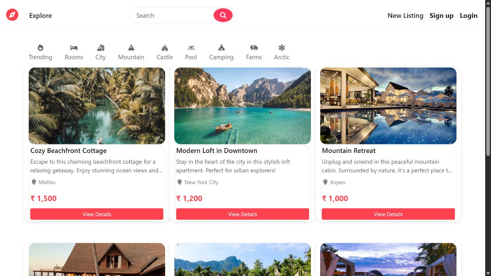

# Wanderlust

A full-stack accommodation-listing application with server-rendered pages, user accounts, reviews, image uploads, and map integration.

## Interface

The actual EJS listings template rendered locally with the repository's sample listing data. This screenshot demonstrates the interface, not a deployed or end-to-end tested service.

## Features

- Browse listings and inspect individual properties
- Create and manage listings
- Register and sign in with Passport
- Add reviews, with authorization middleware
- Cloudinary image uploads and Mapbox location integration

## Stack

Node.js, Express, EJS, Bootstrap, MongoDB, Mongoose, Passport, Joi, Cloudinary, and Mapbox.

## Run locally

1. Use the Node.js version declared in `package.json` and run `npm ci`.
2. Create `.env` with `ATLASDB_URL`, `CLOUD_NAME`, `CLOUD_API_KEY`, `CLOUD_API_SECRET`, and `MAP_TOKEN` for your own development services.
3. Run `node app.js`.
4. Visit `http://localhost:8080/listings`.

`init/data.js` contains sample listings. Inspect the initializer before running it; use a separate development database.

## Structure

- `controllers/` and `routes/`: listing, review, and account behavior
- `models/`: MongoDB documents
- `views/`: EJS interface templates
- `public/`: styles and client-side scripts
- `schema.js` and `middleware.js`: validation and authorization

This is a learning project. Review session configuration, validation, and service credentials before using it outside a local development environment.
